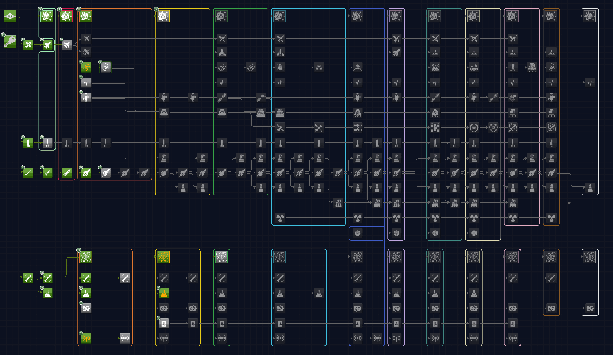

# RP-1 TechTree Kompacted Outlines

Draws colored outlines around each blue sky tech and the techs it unlocks in [RP-1 TechTree Kompacted](https://spacedock.info/mod/3495).

## Installing

Install with [CKAN](https://github.com/KSP-CKAN/CKAN), or download the latest zip from [releases](https://github.com/sparr/ksp-mod-RP1TechTreeKompactedOutlines/releases) and copy `GameData/RP1TechTreeKompactedOutlines` into your KSP `GameData` folder.

Requires KSP 1.12, ModuleManager, and RP-1 TechTree Kompacted.

## Configuration

`GameData/RP1TechTreeKompactedOutlines/Outlines.cfg` holds the line thickness, padding, corner radius, and opacity.

Nothing about the tree itself is configured. The blue sky techs are the ones RP-1 types as materials science or electronics research, and each era's color is read from the frame of their icons. An era spans from its blue sky techs' column up to the next era's column, and each blue sky tech gets a box around itself and the techs in that span that depend on it, directly or through other techs. Techs that RP-1 hides for being empty are left out.

So each era usually has two boxes in its color, one for materials science and one for electronics research. They overlap where a tech depends on both. A tech that depends on neither is in no box, and if it sits inside one, the box narrows to pass it on the right. A tech that requires a blue sky tech directly but sits among a later era's columns is reached by a tab out of the right side of the box.

RP-1 TechTree Kompacted also colors the icon frames of most techs by era. This mod removes that frame from every tech except the blue sky techs, so the color marks only the tech that opens each box.

## Building

You need the [.NET SDK](https://dotnet.microsoft.com/download) (8 or later) and a KSP 1.12 install.

1. Copy `RP1TechTreeKompactedOutlines.props.user.example` to `RP1TechTreeKompactedOutlines.props.user` and set the path to your KSP install. Alternatively, set the `KSP_ROOT` environment variable.
2. Run `dotnet build`.

The plugin is written to `GameData/RP1TechTreeKompactedOutlines/Plugins/`. Symlink or copy `GameData/RP1TechTreeKompactedOutlines` into a KSP install to run it.

## License

MIT. See `LICENSE`.
